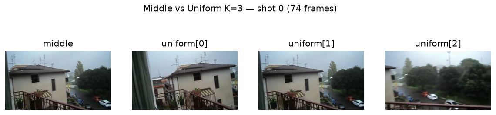
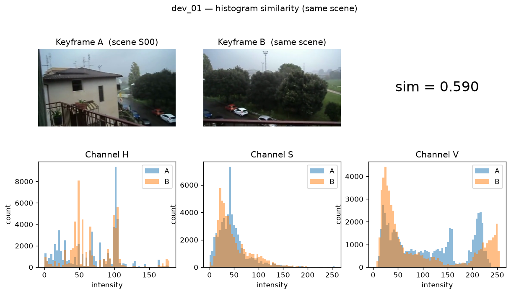
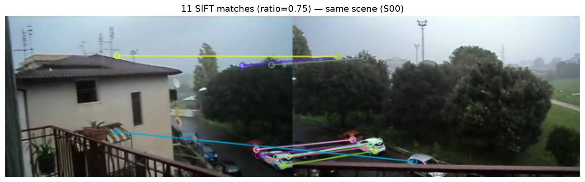

# Computer Vision 2026-2027 - NOVA FCT

## Project Stage 1 - Shot boundary detection and recurring scenes

**Authors**:
- Student number, name, email
- Student number, name, email

## 1. Introduction

## 2. Part 1 - Frame dissimilarity and hard cuts

## 3. Part 2 - Gradual transitions and false alarms

## 4. Part 3 - Recurring scenes

### 4.1 Task 5: Shot representation by keyframes

Each shot has tens to hundreds of frames. Comparing every frame of one shot
with every frame of another is inefficient, so we reduce each shot to a small 
set of **keyframes**:

| Strategy | Rule | # keyframes |
|---|---|---|
| `middle` | `frames[(start + end) // 2]` | 1 |
| `uniform` | `K` frames evenly spaced via `np.linspace(start, end, K)` | K (3–5) |

`np.unique` on the indices avoids duplicates when a shot is shorter than `K`
(e.g. a 3-frame shot with K=10 returns only 3 keyframes).

**Choice of K.**  Two constraints bound the initial range:

- **Coverage** A shot has three visually distinct phases. K=3 is the 
  smallest value that samples all three;
  K<3 misses a phase and has no redundancy against an outlier keyframe.
- **Cost** The number of keyframe pairs between two shots
  grows as K², making SIFT much slower as K grows and can push the full
  run past the 5-minute budget.

We started with **K=3** and tune it in the K-sweep of Section 5.1
(K ∈ {1, 3, 5, 8}), where the extra keyframes must justify their cost.

**Aggregating keyframe similarities.** For two shots with `K_a` and `K_b`
keyframes we get `K_a × K_b` pairwise similarities. These are collapsed into
one shot-to-shot value with:

- **`max`** — the strongest pair and the *Default for SIFT*
- **`mean`** — average
- **`vote`** — count of pairs with similarity > 0.5

The final choice is validated empirically in Section 5.1 (2×2 comparison).

*Figure 1 — Shot 0 of `dev_01` represented by `middle` (left, 1 frame) and `uniform K=3` (right, 3 frames). The uniform strategy samples the shot across its visual phases; the middle strategy captures only the central state. The K-sweep in 5.1 measures whether the extra coverage translates into better discrimination.*

**Implementation validation.** Two families of tests were run before
integrating the function into the pipeline:

- `aggregate_similarities` — 9 input→output cases covering the three
  aggregators across three list shapes (3-element, empty, 1-element),
  plus an unknown-aggregator case that must raise `ValueError`. All
  passed.
- `extract_keyframes` — two edge cases: (i) a 3-frame shot with `K=10`
  returns only 3 keyframes, confirming `np.unique` caps the output;
  (ii) an unknown strategy raises `ValueError` rather than silently
  returning `None`. Both passed.

### 4.2 Task 6: Shot similarity

#### 4.2.1 Colour similarity

Each keyframe is described by a 3D histogram. Similarity is one minus the
χ² distance:

$$
\chi^2(h_1, h_2) = \tfrac{1}{2}\sum_i \frac{(h_1[i] - h_2[i])^2}{h_1[i] + h_2[i]},
\qquad \mathrm{sim} = 1 - \chi^2 \in [0, 1]
$$

Both histograms are L1-normalised, so χ² ∈ [0, 1] and sim = 1
iff the distributions are identical. A small ε = 1e-10 in the denominator
avoids 0/0 on empty bins.

**Bin resolution** Each frame has 320 × 180 = 57 600
pixels, and a 3D histogram with `B` bins has on average 57 600 / B pixels
per bin. We sweep over four resolutions on both
development videos to choose the optimal number of bins:

| Video | bins | same | diff | gap | pixels/bin |
|---|---|---|---|---|---|
| dev_01 | 8×8×8 | 0.5900 | 0.3777 | 0.2123 | 112.5 |
| dev_01 | 16×16×16 | 0.5079 | 0.3023 | 0.2056 | 14.1 |
| dev_01 | 30×32×32 | 0.4413 | 0.2598 | 0.1815 | 1.9 |
| dev_01 | 60×64×64 | 0.3639 | 0.2324 | 0.1316 | 0.23 |
| dev_02 | 8×8×8 | 0.8724 | 0.5862 | **0.2862** | 112.5 |
| dev_02 | 16×16×16 | 0.7874 | 0.4943 | 0.2931 | 14.1 |
| dev_02 | 30×32×32 | 0.6973 | 0.4221 | 0.2751 | 1.9 |
| dev_02 | 60×64×64 | 0.5677 | 0.3296 | 0.2381 | 0.23 |

The gap shrinks **consistently across both videos** as bins grow finer.
`8³` and `16³` are statistically tied (mean gap 0.2493 vs 0.2494) and 
both beat `30×32²`.

We adopt **`8³`** as default because it preserves the widest gap
and is 8× cheaper to compute than `16³` (512 vs 4 096 bins per histogram).
`16³` is kept as a candidate to re-evaluate in the full 2×2 comparison
(Section 5.1), where every pair of shots is evaluated instead of a single
pair.

**Colour space: HSV vs. RGB.** The theoretical argument for HSV is that a
flash brightens the three RGB channels together (shifting every bin) while
in HSV only V shifts and H and S stay, so the metric is robust to
illumination changes. Measurements at the `8³` resolution show exactly how 
much better HSV is compared to RGB, in this situation:

| Video | Space | same | diff | gap |
|---|---|---|---|---|
| dev_01 | **HSV** | 0.5900 | 0.3777 | **0.2123** |
| dev_01 | RGB | 0.7529 | 0.6740 | 0.0789 |
| dev_02 | **HSV** | 0.8724 | 0.5862 | **0.2862** |
| dev_02 | RGB | 0.9323 | 0.7688 | 0.1636 |

*Figure 2 — Colour similarity of two keyframes from the same scene (`dev_01`, scene `S00`). Top: the two keyframes. Bottom: the marginal distributions of H, S and V.*

**Decision.** We adopt **HSV with `8³`**. It is the only combination that
(i) keeps the discrimination gap near its maximum on both development
videos and (ii) is computationally cheaper.

#### 4.2.2 Local-feature similarity (SIFT)

The colour similarity of 4.2.1 captures the overall distribution of pixels
across HSV cells but is blind to spatial structure. Two images with
inverted layouts may share an almost identical histogram. 

**Pipeline.** For each keyframe pair:

1. Detect keypoints and compute 128-dimensional descriptors on the
   grayscale keyframe (`cv2.SIFT_create(nfeatures=500)`).
2. `BFMatcher(NORM_L2).knnMatch(des1, des2, k=2)`: for each descriptor
   in `kf1`, find the two nearest descriptors in `kf2`.
3. **Lowe's ratio test**: keep a match only if
   `d(NN1) / d(NN2) < 0.75`.
4. The **similarity** is the number of surviving matches, an unbounded
   integer. This is why the aggregator `max` is
   mandatory for SIFT, as `mean`/`vote` would need prior normalisation to
   `[0, 1]`.

*Figure 3 — SIFT matches between two keyframes from the same scene (`dev_01`, scene `S00`) after Lowe's ratio test. Lines connect descriptor correspondences; the number of surviving matches (11) is the similarity metric used by `sift_similarity`.*

**Parameter choices:** `nfeatures=500` and `ratio=0.75`. Both justified
empirically in **8.4**.

## 5. Results (development and test)

## 6. Analysis and failure cases

## 7. Conclusion and self-evaluation

## 8. Extras

### 8.1 Combined similarity (colour + features)

**Motivation.** The assignment's extras list
proposes combining them into a single shot similarity.

**Method.** We blend the two normalised similarities with a convex weight
`α ∈ [0, 1]`:

$$
\mathrm{sim}(k_1, k_2) = \alpha \cdot h(k_1, k_2) + (1-\alpha) \cdot \hat{s}(k_1, k_2)
$$

where `h` is `histogram_similarity`, `s` is `sift_similarity`, and
`ŝ = s / min(len(kp1), len(kp2))` normalises the SIFT count to `[0, 1]`.
The endpoints `α=1` and `α=0` reproduce the isolated signals exactly,
which validates the implementation.

**Results** (dev_01 + dev_02 in [0, 1] units):

| Video | α=0.00 | α=0.25 | α=0.50 | α=0.75 | α=1.00 |
|---|---|---|---|---|---|
| dev_01 gap | 0.0627 | 0.1001 | 0.1375 | 0.1749 | **0.2123** |
| dev_02 gap | 0.1253 | 0.1656 | 0.2058 | 0.2460 | **0.2862** |

**Interpretation.** The gap grows **linearly** with α. On this specific test pair, 
the histogram dominates.

**But the test pair is not representative.** It compares the *first* and
*last* shot of the same scene. 
The blend's hypothesis (that SIFT and colour fail on disjoint regimes) 
can only be tested on the full shot × shot matrix. 
We therefore defer the α choice to the 2×2 comparison in 5.1 and keep 
`α=1` as the interim default (equivalent to the histogram alone). 

### 8.2 Colour space comparison (Lab vs HSV vs RGB)

**Motivation.** 4.2.1 justifies HSV through theoretical considerations
(chromaticity decoupled from luminance). But does Lab
discriminate better than HSV on real footage?

**Method.** The same χ² and 3D-histogram pipeline, applied in three
colour spaces. The refactor inside `histogram_similarity` allows the
colour space to be swapped as a single parameter.

**Results:**

| Video | Space | same | diff | gap |
|---|---|---|---|---|
| dev_01 | HSV | 0.5900 | 0.3777 | 0.2123 |
| dev_01 | **Lab** | 0.7836 | 0.5017 | **0.2819** |
| dev_01 | RGB | 0.7529 | 0.6740 | 0.0789 |
| dev_02 | **HSV** | 0.8724 | 0.5862 | **0.2862** |
| dev_02 | Lab | 0.9213 | 0.7427 | 0.1786 |
| dev_02 | RGB | 0.9323 | 0.7688 | 0.1636 |
| mean | **HSV** | — | — | **0.2493** |
| mean | Lab | — | — | 0.2303 |
| mean | RGB | — | — | 0.1213 |

**Interpretation.** The result is **mixed**:

- **Lab wins on dev_01** (+33% gap)
- **HSV wins on dev_02** (+60% gap)

**Decision.** **HSV** is retained, as it wins significantly with dev_02 and 
the difference between Lab and HSV on dev_01 is not that significant.
`lab_similarity` remains in the code as a competitive alternative; 
the 2×2 comparison in 5.1 will confirm whether Lab's performance on larger 
data justifies a swap.

### 8.3 RANSAC transformation model 

**Scope.** The assignment suggests RANSAC + homography for **Part 2**, 
so we tested it in the Task 6 pipeline as an exploration of whether 
geometric filtering could further clean up SIFT matches.

**Method.** Four models, all fitted with RANSAC where applicable, on the
same three keyframes used in 4.2.2 (`nfeatures=500`, `ratio=0.75`):

| transform | DOF | 
|---|---|---|
| `none` (baseline) | — |
| `translation` | 2 | 
| `similarity` | 4 |
| `affine` | 6 | 
| `homography` | 8 |

**Results:**

| Video | transform | same | diff | gap | time |
|---|---|---|---|---|---|
| dev_01 | none | 15 | 11 | 4 | 1.2 ms |
| dev_01 | translation | 8 | 1 | 7 | 4.6 ms |
| dev_01 | similarity | 10 | 3 | 7 | 2.4 ms |
| dev_01 | affine | 11 | 4 | 7 | 1.9 ms |
| dev_01 | homography | 12 | 6 | 6 | 4.2 ms |
| dev_02 | none | 69 | 6 | **63** | 2.5 ms |
| dev_02 | translation | 1 | 0 | 1 | 3.3 ms |
| dev_02 | similarity | 49 | 3 | 46 | 3.4 ms |
| dev_02 | affine | 49 | 4 | 45 | 3.5 ms |
| dev_02 | homography | 49 | 5 | 44 | 4.7 ms |

**Interpretation.**:

1. **dev_01** Baseline has `same=15, diff=11` — barely
   discriminative. RANSAC raises the gap from 4 to 7. The **benefit is 
   real but small** in absolute terms.
2. **dev_02** Baseline has `same=69, diff=6`. RANSAC rejects 20 **true** 
   matches (`same`: 69 → 49) to remove only 1-3 false ones (`diff`: 6 → 3-5).
   The **cost is large**.

The three higher-DOF models (similarity, affine, homography) produce
**nearly identical** results. The extra degrees of freedom
do not add discriminative power here. `translation` fails catastrophically
on dev_02.

**Conclusion.** The conservative default is therefore to
**disable RANSAC for Task 6**. Section 5.1's full 2×2 comparison will
reveal the dataset's actual distribution and the decision can be revisited.

### 8.4 SIFT parameter sensitivity (nfeatures and Lowe's ratio)

**Motivation.** The assignment specifies SIFT + Lowe's ratio test for
Task 6 but does not fix the number of keypoints retained (`nfeatures`)
nor the ratio threshold. We swept both on the development videos to
justify the values used in 4.2.2.

**nfeatures**: maximum keypoints retained by SIFT. Sweep over
`{100, 200, 500, unlimited}`:

| Video | nfeatures | kp_a | kp_b | same | diff | gap | time |
|---|---|---|---|---|---|---|---|
| dev_01 | 100 | 100 | 100 | 7 | 5 | 2 | 31.7 ms |
| dev_01 | 200 | 200 | 146 | 11 | 9 | 2 | 26.6 ms |
| dev_01 | **500** | **307** | **146** | **15** | **11** | **4** | 27.2 ms |
| dev_01 | unlimited | 307 | 146 | 15 | 11 | 4 | 27.2 ms |
| dev_02 | 100 | 100 | 100 | 19 | 0 | 19 | 37.4 ms |
| dev_02 | 200 | 200 | 200 | 33 | 4 | 29 | 39.6 ms |
| dev_02 | **500** | **500** | **500** | **69** | **6** | **63** | 45.4 ms |
| dev_02 | unlimited | 545 | 678 | 75 | 6 | 69 | 45.6 ms |

`nfeatures=500` **doubles the discrimination gap on dev_02** (29 → 63)
at a marginal cost of +6 ms per pair, while unlimited keypoints add only
+6 matches at the same cost. **500 is
the sweet spot.** We therefore set the default to `nfeatures=500`.

**Lowe's ratio**: the ratio threshold. Sweep over `{0.50, 0.60, 0.70,
0.75, 0.80, 0.90}`:

| ratio | dev_01 gap | dev_02 gap | verdict |
|---|---|---|---|
| 0.50 | 4 | 20 | too strict, loses true matches |
| 0.60 | 3 | 23 | idem |
| 0.70 | 2 | 30 | OK |
| **0.75** | **2** | **29** | **stable across both videos** |
| 0.80 | −1 | 38 | unstable (inverts on dev_01) |
| 0.90 | 9 | 32 | too permissive, `diff` explodes |

`0.80` is best on dev_02 but **negative** on dev_01. `0.75` is the
only value that stays stable across both. **We keep `ratio=0.75`.**

## 9. Use of AI tools
